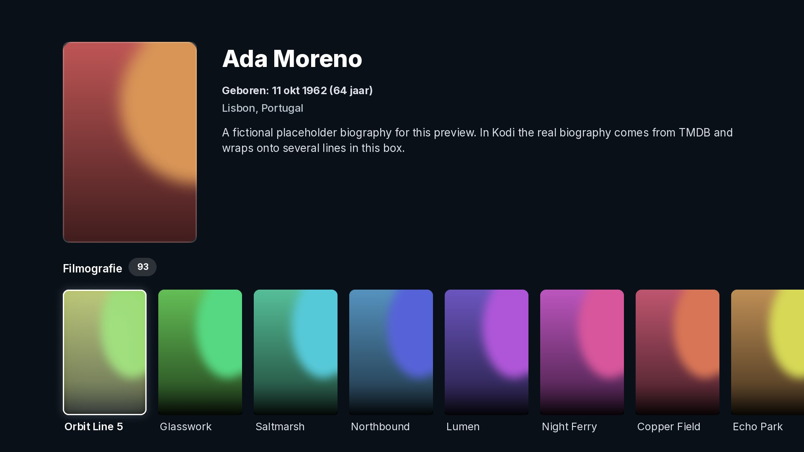
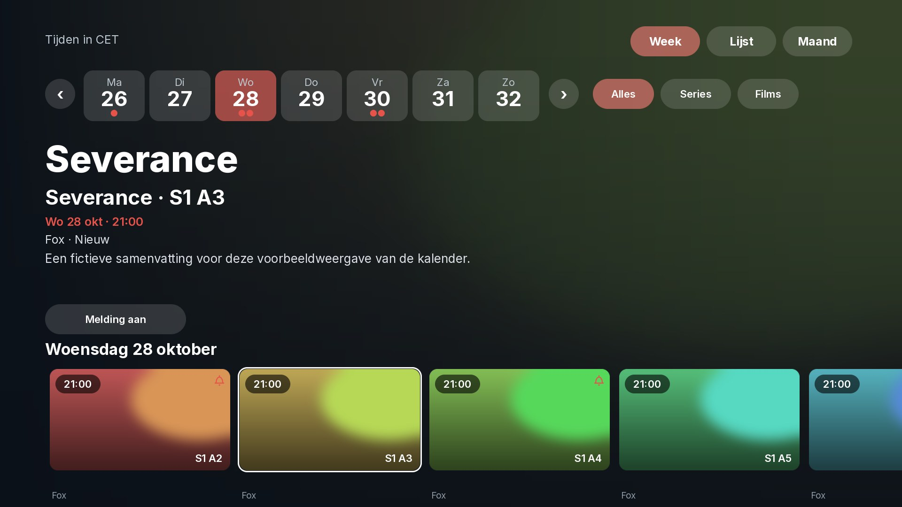
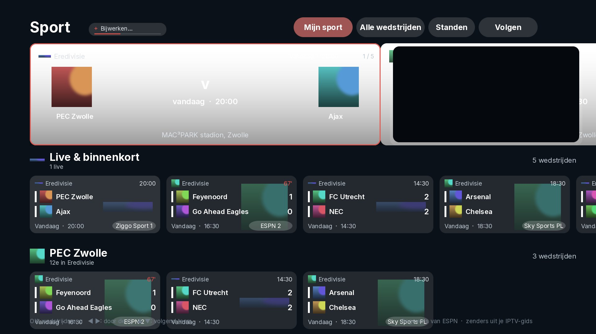

<p align="center"></p>

# Lucent – Kodi skin (Beta 1)

> **Beta:** this is the first public beta. Everything is in place, but expect small bugs – please report them.


**Lucent** is a dark, cinematic Kodi skin in a glass style: large backdrops, glass panels, rounded cards, a white glow on the focused item and the Inter font. Built around **Seren** and **Trakt**, with home rows for continue watching, trending titles, your library and your own Trakt lists.


> The images are previews with placeholder artwork, rendered from the skin files. In Kodi you will see the real backdrops, posters and logos.

**Works with:** Kodi 21 (Omega) and Kodi 22 (Piers) · 1080p

---

## Features

### Home screen
- A big hero area with the backdrop, logo (or title), info pills and plot of the focused item.
- Rows:
  - **Continue watching · Shows** and **Continue watching · Movies** (Seren + Trakt)
  - **Trending movies** and **Trending shows** (Seren)
  - **Recently added movies** and **Recently added episodes** (your Kodi library, only shown if you have one)
  - **Your Trakt lists** – liked lists or your own lists
- Rows are **widgets** that you choose yourself, see *Customising the menu and widgets* below. Empty rows hide themselves.

### Sidebar
A slim icon rail that opens when you press left. Out of the box it has Search, Home, Movies, TV shows, Library, Add-ons, Favourites, Settings and Power, but **every tab can be changed**: its name, icon, what it opens when you click it, and its own widgets. When you move through the tabs, the home screen shows the widgets of that tab.


### Five views for lists and Seren menus

| View | Best for |
| --- | --- |
| **Posters** | Hero info at the top and one row of posters |
| **Poster wall** | A full grid of posters |
| **Episodes** | Episode list with thumbnail, date and plot |
| **Landscape** | Hero info and one row of 16:9 cards |
| **List** | Menus and folders, with artwork and plot on the right |

The skin picks a fitting view automatically. You can change it with the **View** button at the top right.

### Info page
Everything on one page. At the top: logo, buttons, director, ratings (IMDb, TMDB, Trakt), plot, genres, release date and details. Scroll down for tabs **Cast and crew | Similar titles | Trailers** (left/right switches them), the **collection** the film belongs to (for example all Toy Story films, via TMDB) and the **production companies** with their logos.

- **Library and lists** – tick where the title should be: your Seren library (Trakt collection), your Trakt watchlist and your own Trakt lists.
- **Mark as watched** – marks it as watched or not watched on Trakt.
- **Click a cast member or the director** to open their page: photo, birthday, place of birth, biography and filmography (via TMDB).
- **Click a studio** under Production to see its logo, where it is from and its most popular films and series.
- **Click a title** under Similar titles, in the collection, or on an actor or studio page to open its own info page. **Play** always goes through Seren.
- **Back walks the whole way back**: film → actor → film → Back brings you to the actor, Back again to the film you started from.
- **Trailer** plays the trailer and brings you back to the page afterwards.

The Trakt parts use your Trakt login from Seren. Cast, collections, studios and the pages opened from them need a free **TMDB API key**: Lucent uses the one you entered in Seren, or enter your own in **Skin settings → Integrations → TMDB API key** (get one for free at [themoviedb.org](https://www.themoviedb.org/settings/api)). Studio logos come from the studio logo packs (installed with the skin); a studio that is not in the pack gets its logo from TMDB.

### Calendar
A **Calendar** tab (Week, List and Month) for the series and films of your Trakt collection that you follow with the bell on the info page. A pop-up tells you when a new episode is out (*Watch now / Later*) or when a film is released digitally. The series open straight on their seasons in Seren.

### Sport (needs IPTV channels)
A **Sport** tab with games from almost 200 competitions (football worldwide, NBA, NFL, NHL, MLB, rugby, Formula 1, IndyCar, NASCAR, golf, tennis, UFC and more), fetched from ESPN. It only appears when Kodi has TV channels.

- **My sport** – a big card with your next game in the two club colours, a small live TV window and a row of cards for every team, country or competition you follow.
- **All games** and **Tables** – every game with its channel, and league tables with form, place changes and Champions League / relegation colours.
- **Follow** – follow teams, countries or whole competitions, with their own icons and logos.
- **Game page** – score, LIVE minute, your channels (from your IPTV guide), statistics, latest goals and the table. Formula 1 has its own page: circuit drawing, length, laps, turns, lap record, the weekend programme as cards and the top 10 of every finished session.
- **Reminders, automatic switching and recording** – a reminder 5 minutes before, optional switching to the channel, recording for 1 to 6 hours, and *Fix channel* per game, competition or team.
- OK on a channel plays it in the small TV window, OK again goes full screen.

### TV guide and live TV
A **TV** tab with your IPTV channels: groups on the left, channels with logo and number, a timeline with the programmes, a header with the focused programme and a live preview. A *Favourite group* opens first every time. The live TV player has its own compact info bar (channel, LIVE, quality, score, now and next) and a menu with channel up/down, pause, record, subtitles, audio and recent channels.
- **Xtream login**: enter your provider's server address, user name and password (setup assistant → Live TV, or Settings → Live TV); Lucent checks the login and sets up IPTV Simple Client (channel list, guide, replay).

### Subtitles and updates
- **Lucent Subtitles** – Lucent's own subtitle add-on (installed with the skin): asks OpenSubtitles, SubDL and Podnapisi at the same time with a time limit, puts subtitles that fit your exact video first (file hash and release name), finds season packs and saves everything as UTF-8. Needs a free OpenSubtitles account with an API key (*Profile → API consumers*) and a free SubDL API key; Podnapisi works without. Fill them in via the setup assistant or *Skin settings → Integrations → Subtitle add-on settings*.
- A *Search subtitles* button in the player menu and optional automatic search when a film or episode starts without subtitles in your language.
- **Update pop-up** – when a new version is out you can choose *Update now*, *Later* or *Skip this version* (switch in Skin settings → Integrations).

### Lucent Library (your collection as a Kodi library)
**Lucent Library** (`script.lucent.library`, installed with the skin) turns your Trakt collection into Kodi's own library: films and series as small `.strm` files that play through Seren, kept up to date in the background.

> **Important:** first load your **whole collection in Seren** – open *Movies > My movies (collection)* and *TV shows > My shows (collection)* in Seren and wait until everything is in. Lucent Library only takes over what Seren already knows; titles Seren has not loaded yet are added on a later run.

New episodes are added **one day after they aired** (before that a source often has no link yet). Films and series in the library get the same **IMDb, Trakt and TMDB scores** as in Seren.

Settings: *Skin settings > Integrations > Lucent Library* (update now, update every 6/12/24 hours, watched marks to Trakt, Surprise me).

### Also in the home menu
The **Add-ons** item shows rows of your favourites and your video, program and music add-ons. The **Profiles** screen has icons for each profile.

### Setup assistant
The first time Lucent opens, a short assistant walks through Seren and Trakt, the TMDb key, live TV (IPTV Simple), playback (buffer, refresh rate, surround passthrough), subtitles, Lucent Library, the look and a backup – each step shows how it stands and has a button to set it up. Open it again via *Skin settings > Setup assistant* or *Settings > About > Setup assistant*.

### Sleep timer
The player menu has a moon button: stop after this episode or film, or after 15, 30, 45, 60 or 90 minutes (the next episode does not start by itself). The time left shows under the button.

### Kids mode
*Skin settings > Kids mode*: choose a PIN and which side-menu items stay. In kids mode the Options button on the info page is gone and the settings ask for the PIN; *Kids mode off* sits at the bottom of the side menu. It locks the menu – it does not filter what Seren shows.

### Backup and restore
*Skin settings > Backup and restore*: one zip file (USB stick or network share) with Lucent's settings and menu, Kodi's favourites and sources, and the settings of Seren, IPTV Simple, Lucent Library and Lucent Subtitles. Restoring puts it all back and restarts Kodi. The backup holds your logins – keep it to yourself.

### Light mode
For boxes with little memory (on by itself with 2 GB or less): Home builds only six rows – rows 7–10 are not created at all – Seren is asked for small artwork, and there is no colour glow and no snow. The skin reloads once when you switch it.

### Options on the info page
For titles in the Kodi library the info page has an **Options** button: edit title, edit sort title, choose art, remove from library.

### Alphabet bar
Under the poster rows of films and series (sorted A–Z) sits a bar **# A B … Z**: the current letter lights up, press Down, pick a letter and OK jumps there.

### Everything else in the same style
All TV (PVR) windows – group and channel manager, programme info, guide search, the channel list while watching. The video player and its menu, seek bar, subtitle search, bookmarks, Kodi settings, add-on settings, add-on info, file manager, keyboard, number pad, notifications, dialogs, power menu, system info and screen calibration.

---

## Screenshots

**Posters**


**Poster wall**


**Episodes**


**List view (Seren menu)**


**Info page**




**Player**


**Settings**


**Skin settings**


**Keyboard**


**Calendar**


**Sport**


---

## Installation

1. Download [`repository.lucent.zip`](https://github.com/djdirty60/Lucent/raw/main/repository.lucent.zip) and copy it to your device, for example to the *Download* folder.
2. In Kodi, go to **Settings → System → Add-ons** and switch on **Unknown sources**.
3. Go to **Add-ons → Install from zip file** and choose `repository.lucent.zip`.
4. Go to **Add-ons → Install from repository → Lucent Repository → Look and feel → Skin → Lucent** and choose **Install**.
5. Kodi asks whether you want to use the new skin. Choose **Yes**.
   (Later: **Settings → Interface → Skin → Lucent**.)

Kodi also installs the YouTube add-on (for trailers) and the white and coloured studio logo packs.


### Automatic updates

Because the skin is installed from the **Lucent Repository**, Kodi keeps it up to date by itself.
From then on new versions arrive automatically (Kodi's default: **Settings → System → Add-ons → Updates → Install updates automatically**).

### Skin settings

**Settings → Skin settings** is laid out with categories on the left, options on the right.

- **Appearance** – colour theme (Glass, White, Crimson, Emerald, Ocean, Violet, Amber, Gold, Rose, Rose Gold, Copper, Jade, Arctic Blue, Graphite), AMOLED mode (pure black), interface scale, font and language, clock, and the screensaver (dim when idle, timeout, dim strength).
- **Layout** – menu and widgets, what OK does on a film or episode (open its page first, or start the stream at once), poster labels, landscape posters on Home, watched titles (show/dim), hide side icons, full release date, fullscreen hero backdrop, edge glow on cards, and the details page (ratings, rating logos, trailer button, studio logos).
- **Content & discovery, Playback, Integrations, Tracking, Profiles, Advanced, About** – shortcuts to the matching Seren and Kodi settings. Integrations also has your TMDB API key, Lucent Subtitles and the update pop-up.

**Rating logos:** the skin does not ship logos of IMDb, TMDB or Trakt. Put your own `imdb.png`, `tmdb.png` and `trakt.png` in `userdata/addon_data/skin.lucent/logos/` and the info page shows them instead of the names.

### Customising the menu and widgets

1. Go to **Settings → Skin settings → Customise menu and widgets**.
2. You see a list of your tabs. Choose a tab to change it:
   - **Widgets on this tab** – add, rename, move or remove widgets. A widget can be:
     - a Seren list (continue watching, trending, popular, anticipated, watchlist, …),
     - one of your **Trakt lists** (liked or your own),
     - something from your **Kodi library**,
     - **any folder of any video add-on** (choose *Browse an add-on…* and walk to the folder you want),
     - your favourites, add-ons or a playlist,
     - more Kodi library lists (random, unwatched, in progress, top rated, sets, genres, music),
     - or a path you type yourself.
     Every widget can be shown as **posters** or **landscape** cards (up to 10 per tab).
   - **Name** and **Icon**.
   - **When clicked** – show the widgets of this tab, open a Kodi screen (Seren, library, music, add-ons, every settings page, power options), open a folder of an add-on, start an add-on, open one of your favourites, or a Kodi command you type yourself.
   - **Move up / Move down**, **Make this the start tab**, **Remove this tab**.
3. **+ Add a tab** adds a new tab (up to 12).
4. **Restore the default menu** puts everything back the way it was.

A tab without widgets shows the widgets of the start tab.

### Back to the default skin

**Settings → Interface → Skin → Estuary.**

---

## Good to know

- **Seren is optional.** Without Seren the Seren rows are hidden and the skin works with your Kodi library only. With Seren, enter a free **Fanart.tv API key** in Seren for more logos.
- **Pairs with the Seren theme** [Lucent for Seren](https://github.com/djdirty60/Seren-Thema), so Seren's source select, scraping and playing-next windows match the skin.
- **Remote:** the Home button of the remote goes to the Home screen from almost every window (not yet on the film / series page on every box). In lists with a scroll bar (file browser, settings) press Right to get on the bar, then Up/Down scroll a page at a time.
- **Screen size:** Kodi scales the skin to any resolution (720p, 1080p, 4K) by itself. If you see black edges or the picture is cut off, use **Skin settings → Calibrate the picture**.
- **Not styled:** games and weather. Those windows won't open while this skin is active; switch to Estuary temporarily if you need them. Live TV has the TV guide and player of this skin, but other PVR windows (recordings, timers) still need Estuary.
- Feedback and bug reports are welcome – please open an issue and include a photo of the screen or your `kodi.log` if something looks wrong.

---

## Folder structure

```
addon.xml            add-on info (id: skin.lucent)
xml/                 all windows and includes
media/               textures, icons, badges
fonts/               Inter font + licence
colors/              colour palette
language/            English and Dutch strings
scripts/menu.py      editor for the side menu and the widgets
scripts/info.py      info page: collection, studios, person / studio pages, opening titles and going back, Trakt lists and watched
scripts/agenda*.py   Calendar tab
scripts/sport*.py    Sport tab (ESPN games, tables, F1 page, reminders)
scripts/tv.py        TV tab and guide, live.py = live TV player
scripts/subtitles.py Lucent Subtitles as the subtitle service
scripts/updater.py   update pop-up
resources/           icon and fanart
repo/                Kodi repository (addons.xml + zips) for automatic updates
repository.lucent.zip  the repository add-on to install once
screenshots/         images for this README
```

---

## Credits and licences

- Inspired by the design of [Nuvio Arc](https://github.com/ysosrs123/NuvioTV-Fork). This skin is not affiliated with it.
- Home rows use [Seren](https://github.com/nixgates/plugin.video.seren) by Nixgates (also works with forks of it).
- Sport data comes from ESPN. This skin is not affiliated with Seren either.
- Font: [Inter](https://github.com/rsms/inter) by Rasmus Andersson, SIL Open Font License 1.1 (see `fonts/Inter-LICENSE.txt`).
- Icons and badges are original designs. The badges are not official Dolby or DTS logos.
