# Nuvio Arc – Kodi skin (NOT FOR USE IN TEST PHASE)

A dark, cinematic Kodi skin inspired by **Nuvio Arc V2** (Cinematic Glass): large backdrops, glass panels, rounded cards, a white glow on the focused item and the Inter font. Built around **Seren** and **Trakt**, with home rows for continue watching, trending titles, your library and your own Trakt lists.

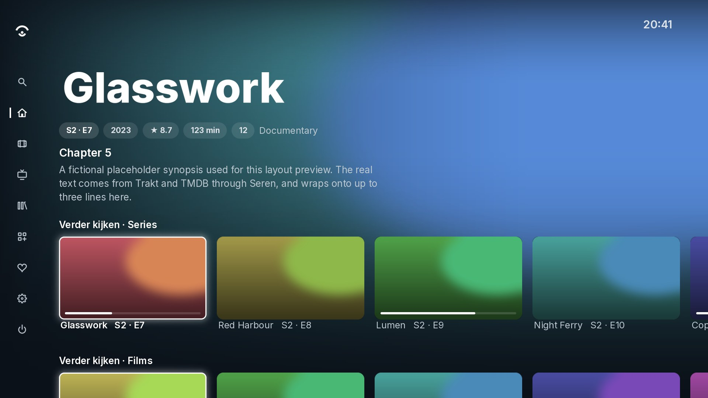

> The images are previews with placeholder artwork, rendered from the skin files. In Kodi you will see the real backdrops, posters and logos.

**Works with:** Kodi 21 (Omega) and Kodi 22 (Piers) · 1080p

---

## Features

### Home screen
- A big hero area with the backdrop, logo (or title), info pills and plot of the focused item.
- Rows, like in Nuvio:
  - **Continue watching · Shows** and **Continue watching · Movies** (Seren + Trakt)
  - **Trending movies** and **Trending shows** (Seren)
  - **Recently added movies** and **Recently added episodes** (your Kodi library, only shown if you have one)
  - **Your Trakt lists** – liked lists or your own lists
- Rows are **widgets** that you choose yourself, see *Customising the menu and widgets* below. Empty rows hide themselves.

### Sidebar
A slim icon rail that opens when you press left. Out of the box it has Search, Home, Movies, TV shows, Library, Add-ons, Favourites, Settings and Power, but **every tab can be changed**: its name, icon, what it opens when you click it, and its own widgets. When you move through the tabs, the home screen shows the widgets of that tab.

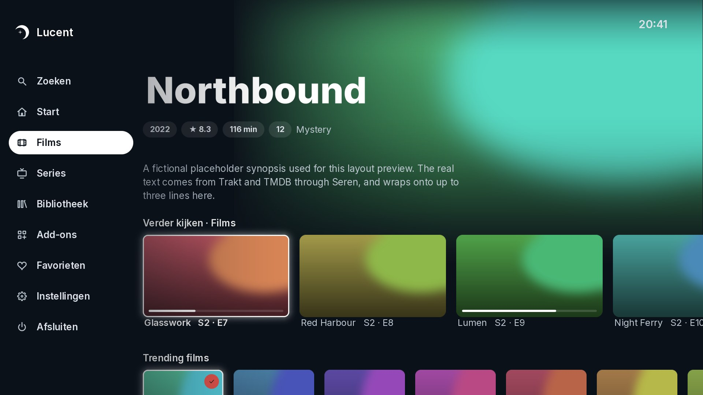

### Five views for lists and Seren menus

| View | Best for |
| --- | --- |
| **Posters** | Hero info at the top and one row of posters |
| **Poster wall** | A full grid of posters |
| **Episodes** | Episode list with thumbnail, date and plot |
| **Landscape** | Hero info and one row of 16:9 cards |
| **List** | Menus and folders, with artwork and plot on the right |

The skin picks a fitting view automatically. You can change it with the **View** button at the top right.

### Info page
Everything on one page. At the top: logo, buttons, director, ratings (IMDb, TMDB, Trakt), plot, genres, release date and details. Scroll down for tabs **Cast and crew | Similar titles | Trailers** (left/right switches them), the **collection** the film belongs to (for example all Toy Story films, via TMDB) and the **production companies**.

- **Library and lists** – tick where the title should be: your Seren library (Trakt collection), your Trakt watchlist and your own Trakt lists.
- **Mark as watched** – marks it as watched or not watched on Trakt.

These use your Trakt login from Seren, there is nothing new to set up. For studio logos, use **Skin settings → Install studio logos**.

### Everything else in the same style
The video player and its menu, the video player and its menu, seek bar, subtitles search, bookmarks, Kodi settings, add-on settings, add-on info, file manager, keyboard, number pad, notifications, dialogs, power menu and screen calibration.

---

## Screenshots

**Posters**
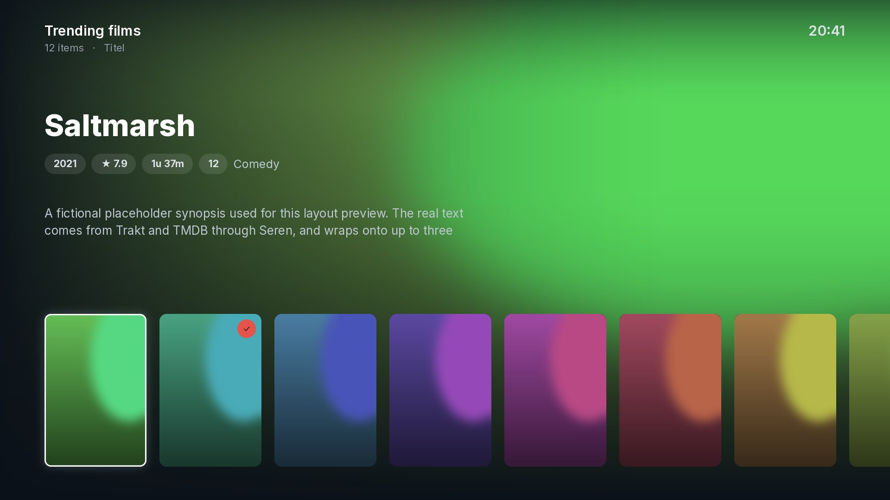

**Poster wall**
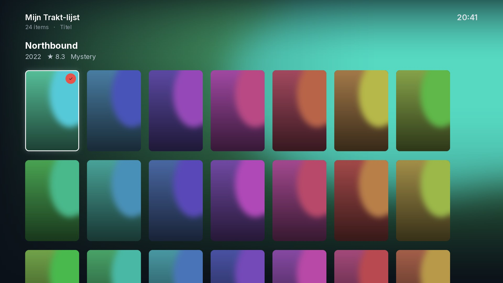

**Episodes**
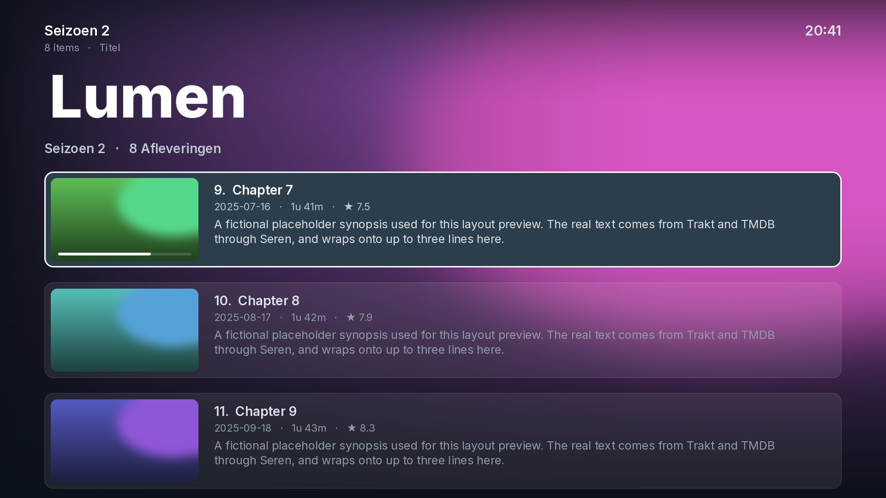

**List view (Seren menu)**
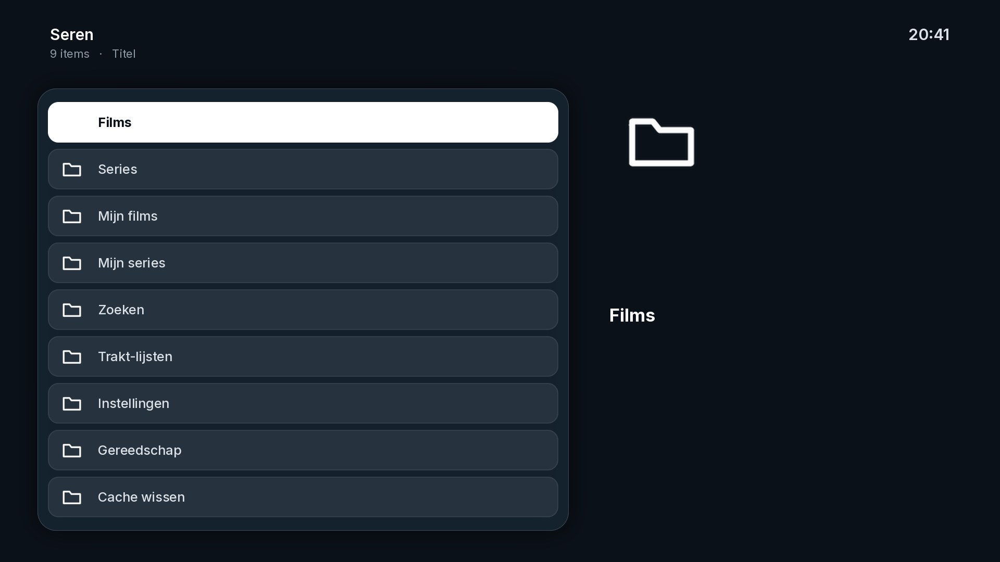

**Info page**
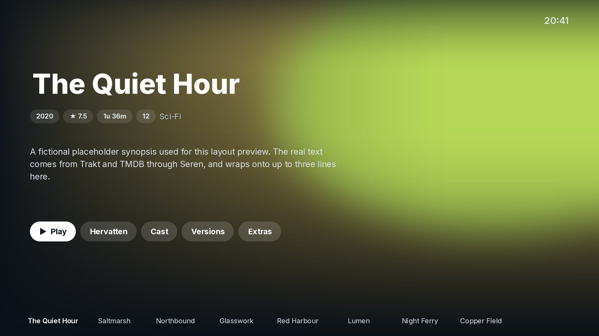
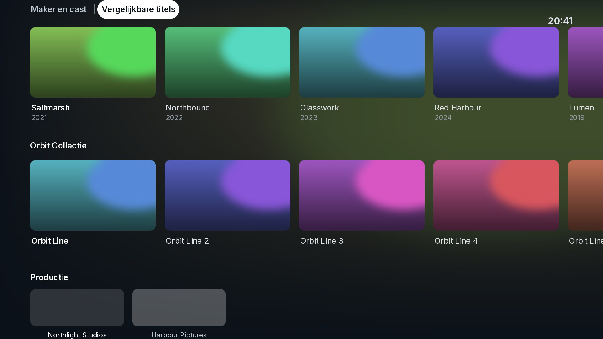

**Player**
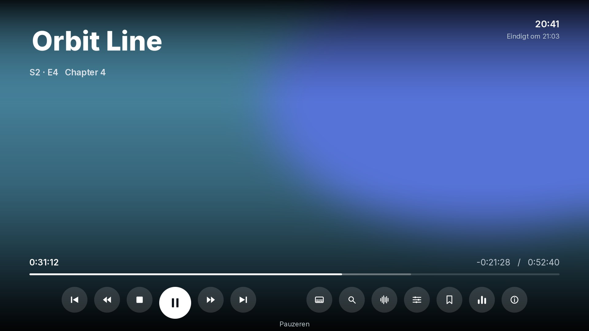

**Settings**
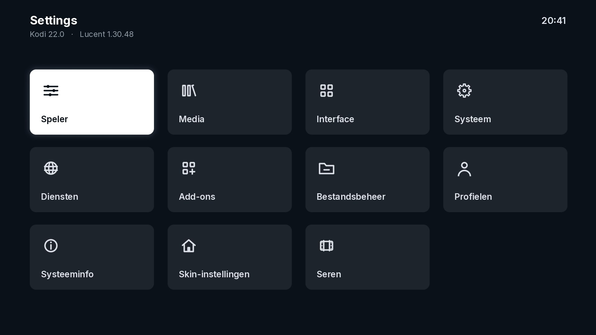

**Skin settings**
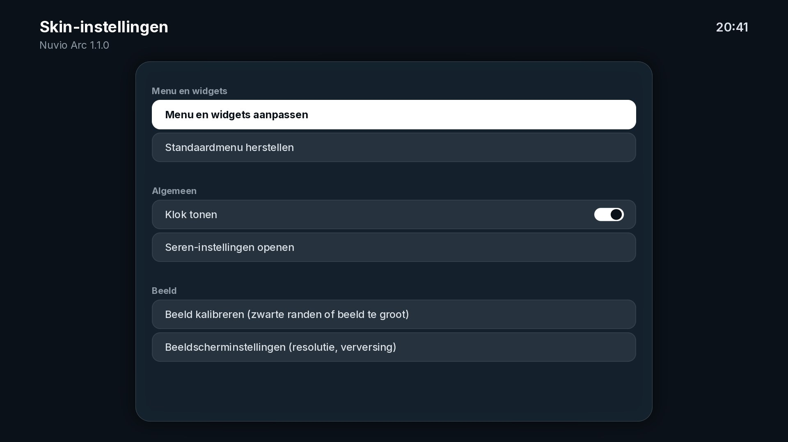

**Keyboard**
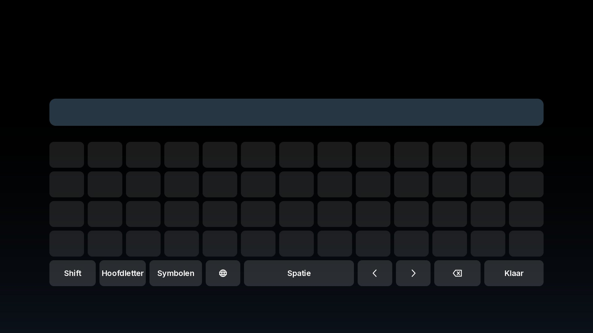

---

## Installation

1. Download `skin.nuvioarc-1.2.3.zip` from the [Releases page](../../releases/latest).
   Don't use the green **Code → Download ZIP** button: Kodi needs the folder inside the zip to be called `skin.nuvioarc`, and only the release zip is built that way.
2. Copy the file to your device, for example to the *Download* folder.
3. In Kodi, go to **Settings → System → Add-ons** and switch on **Unknown sources**.
4. Go to **Add-ons → Install from zip file** and select `skin.nuvioarc-1.2.3.zip`.
5. Kodi asks whether you want to use the new skin. Choose **Yes**.
   (Later: **Settings → Interface → Skin → Nuvio Arc**.)

### Automatic updates (recommended)

Install the **Nuvio Arc Repository** once, then Kodi keeps the skin up to date by itself.

1. Download [`repository.nuvioarc.zip`](https://github.com/djdirty60/Skin-Nuvio-Arc/raw/main/repository.nuvioarc.zip) and copy it to your device.
2. In Kodi go to **Add-ons → Install from zip file** and choose `repository.nuvioarc.zip`.
3. Go to **Add-ons → Install from repository → Nuvio Arc Repository → Look and feel → Skin → Nuvio Arc** and choose **Install** (or **Update**).
   If the skin is already installed, choose **Versions** and pick the newest version from *Nuvio Arc Repository*. This links the skin to the repository.

From then on new versions arrive automatically (Kodi's default: **Settings → System → Add-ons → Updates → Install updates automatically**).

### Customising the menu and widgets

1. Go to **Settings → Skin settings → Customise menu and widgets**.
2. You see a list of your tabs. Choose a tab to change it:
   - **Widgets on this tab** – add, rename, move or remove widgets. A widget can be:
     - a Seren list (continue watching, trending, popular, anticipated, watchlist, …),
     - one of your **Trakt lists** (liked or your own),
     - something from your **Kodi library**,
     - **any folder of any video add-on** (choose *Browse an add-on…* and walk to the folder you want),
     - or a path you type yourself.
     Every widget can be shown as **posters** or **landscape** cards (up to 10 per tab).
   - **Name** and **Icon**.
   - **When clicked** – show the widgets of this tab, open a Kodi screen, open a folder of an add-on, start an add-on, open one of your favourites, or a Kodi command you type yourself.
   - **Move up / Move down**, **Make this the start tab**, **Remove this tab**.
3. **+ Add a tab** adds a new tab (up to 12).
4. **Restore the default menu** puts everything back the way it was.

A tab without widgets shows the widgets of the start tab.

### Back to the default skin

**Settings → Interface → Skin → Estuary.**

---

## Good to know

- **Seren is optional.** Without Seren the Seren rows are hidden and the skin works with your Kodi library only. With Seren, enter a free **Fanart.tv API key** in Seren for more logos.
- **Pairs with the Seren theme** [Nuvio Arc V2 for Seren](https://github.com/djdirty60/Seren-Thema), so Seren's source select, scraping and playing-next windows match the skin.
- **Screen size:** Kodi scales the skin to any resolution (720p, 1080p, 4K) by itself. If you see black edges or the picture is cut off, use **Skin settings → Calibrate the picture**.
- **Not styled in this version:** Live TV (PVR), games and weather. Those windows won't open while this skin is active; switch to Estuary temporarily if you need them.
- This is a first release. Feedback and bug reports are welcome – please open an issue and include a photo of the screen or your `kodi.log` if something looks wrong.

---

## Folder structure

```
addon.xml            add-on info (id: skin.nuvioarc)
xml/                 all windows and includes
media/               textures, icons, badges
fonts/               Inter font + licence
colors/              colour palette
language/            English and Dutch strings
scripts/menu.py      editor for the side menu and the widgets
scripts/info.py      info page: collection, studios, Trakt lists and watched
resources/           icon and fanart
repo/                Kodi repository (addons.xml + zips) for automatic updates
repository.nuvioarc.zip  the repository add-on to install once
screenshots/         images for this README
```

---

## Credits and licences

- Inspired by the design of [Nuvio Arc](https://github.com/ysosrs123/NuvioTV-Fork). This skin is not affiliated with it.
- Home rows use [Seren](https://github.com/nixgates/plugin.video.seren) by Nixgates. This skin is not affiliated with Seren either.
- Font: [Inter](https://github.com/rsms/inter) by Rasmus Andersson, SIL Open Font License 1.1 (see `fonts/Inter-LICENSE.txt`).
- Icons and badges are original designs. The badges are not official Dolby or DTS logos.
